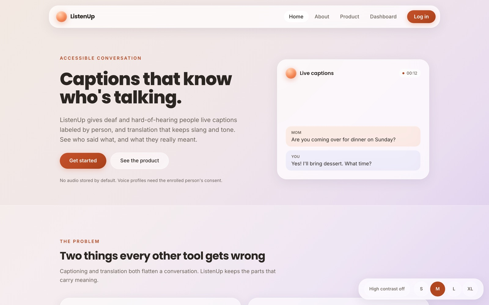
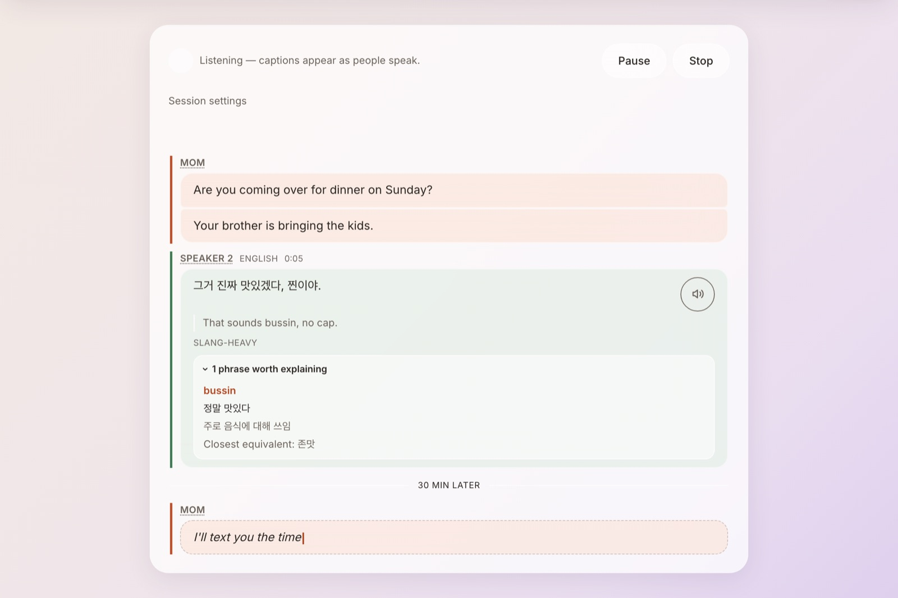
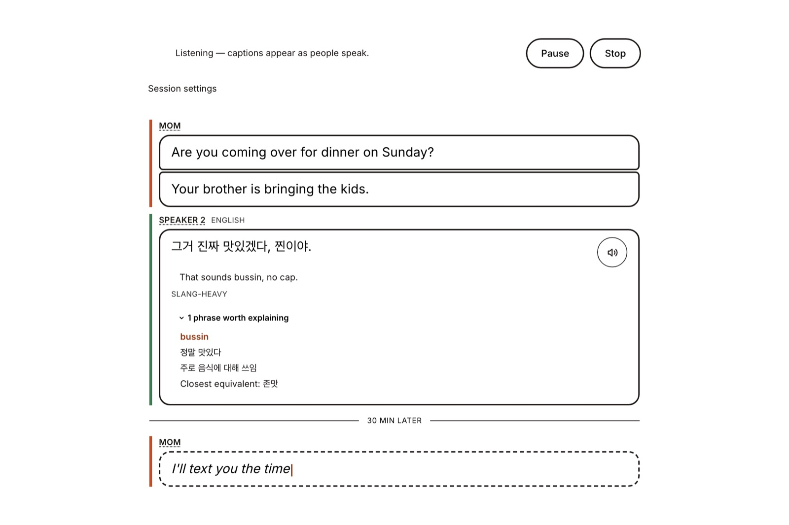
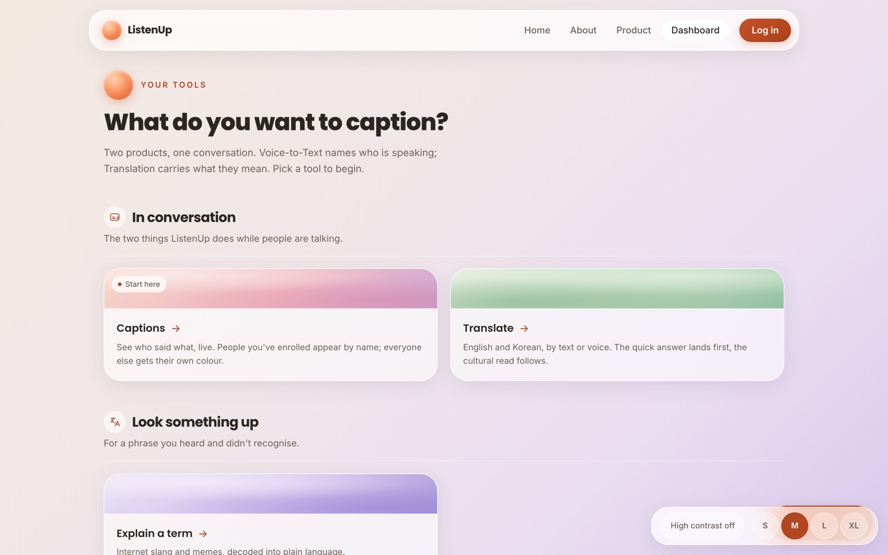
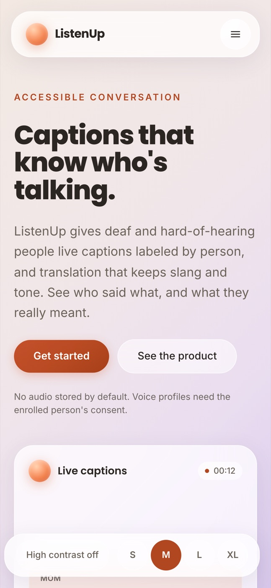
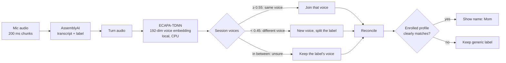
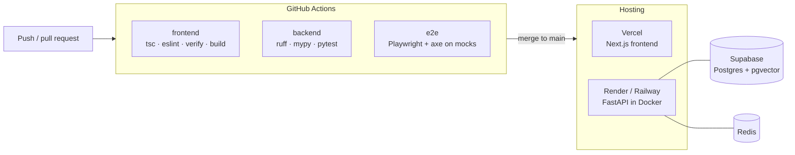

# ListenUp

**Live captions that know who's talking, and translation that knows what they meant.**

ListenUp turns a spoken conversation into captions labelled by person, for deaf and
hard-of-hearing people, and translates between English and Korean with the slang,
register and cultural context kept intact rather than flattened.

<p align="center">
  
</p>

[Live demo](https://listenup-seven.vercel.app) · [Docs index](docs/README.md) · [Design system](docs/design/DESIGN_SYSTEM.md) · [Decisions log](docs/logs/DECISIONS.md)

---

## Mission

Group conversation is where captioning fails people. A transcript that reads as one
undifferentiated stream tells a deaf reader *what* was said but not *who* said it, which
at a family dinner is most of the meaning. Translation fails in the same place from the
other side: it carries the words and drops the slang, the irony and the register, so a
reader gets a sentence that is technically right and socially wrong.

ListenUp is built to fix both, under three commitments that are enforced in code
rather than promised in copy:

- **Accessible first.** WCAG 2.1 AA is build-breaking: high-contrast mode on every
  surface, adjustable caption size, full keyboard and screen-reader support.
- **Never put a wrong name on someone.** Below match confidence a speaker stays
  "Speaker 2". A missing name is an inconvenience; a wrong one is misinformation the
  reader cannot check.
- **Voice is biometric data.** Voice profiles require consent from the person enrolled
  (not just the account holder), can be exported and deleted, and no audio is stored
  by default.

## Features

<table>
  <tr>
    <td width="50%"></td>
    <td width="50%"></td>
  </tr>
  <tr>
    <td align="center"><sub>Speaker-named captions with a cultural translation and slang note</sub></td>
    <td align="center"><sub>Same pane in high-contrast mode, larger caption size</sub></td>
  </tr>
</table>

- **Live captions with speaker names.** Each person gets their own colour and label;
  people with a voice profile appear by name. Tap any label to correct it, and the
  correction follows that *voice* for the rest of the session.
- **Voice profiles.** A 20–30 s guided enrollment, consent-gated, recognised
  automatically in later sessions. Up to 4 named speakers per conversation.
- **Cultural translation (English ↔ Korean).** A fast literal translation appears
  instantly, then upgrades in place to one that renders slang as slang
  (*"That sounds bussin, no cap"* → *"그거 진짜 맛있겠다, 찐이야"*) with notes on meaning, register and the closest equivalent.
  Notes the model could not ground in the slang knowledge base are marked unverified.
- **Explain a term.** Look up a slang word or meme for a plain-language meaning, origin
  and example. Results can be shared as an image card.
- **Read aloud.** Translations are spoken in a matching voice, so ListenUp can act as an
  interpreter for the person across the table. Free browser voices by default, with an
  opt-in premium tier.
- **Pause, resume and plans.** Free / Basic / Pro plans meter characters and minutes.
  Pausing stops both the microphone and the billing clock.

<table>
  <tr>
    <td width="70%"></td>
    <td width="30%"></td>
  </tr>
  <tr>
    <td align="center"><sub>Tool dashboard</sub></td>
    <td align="center"><sub>One responsive app, phone to desktop</sub></td>
  </tr>
</table>

## The hard part: knowing who is speaking

Speech-to-text providers already offer *diarization*, labelling turns as Speaker 0, 1
and 2. Streaming diarization is unreliable in exactly the way that hurts this product:
it renames the same person after a pause, gives a new speaker's first words to the
previous one, and occasionally puts two people under one label. Showing those labels
directly is how one person ends up as Speaker 1, 2 and 3 in a single conversation.

So ListenUp treats the provider's label as a *hint* and decides identity from the voice
itself:



1. **Every finished turn is embedded on the CPU** with SpeechBrain's ECAPA-TDNN, with no
   per-call cost. This runs for every session, signed in or not. Telling that two turns
   came from the same person needs no profile, only a comparison between two voices.
2. **Three bands, not two.** "Not confidently the same" and "confidently different" are
   different claims. Above the match threshold a turn joins that voice, which fixes label
   churn. Below the split floor the audio is evidence of a different person, which fixes
   two people sharing a label. In between, the turn stays with the voice it has: a short
   or off-mic turn is a noisy sample of its own speaker, not evidence of someone new.
3. **Hindsight.** Live clustering commits without seeing what comes next, so a voice's
   first turn is judged against almost nothing. After each turn, `reconcile()` checks
   whether two voices have built up enough evidence to be one person. It requires a
   stricter bar, centroid similarity and at least two turns each. It then relabels the
   captions already on screen, while the older label survives so nothing jumps under the
   reader.
4. **Names are a separate, stricter step.** A voice is named only when it clearly matches
   an enrolled profile, with a margin over the next-best person. Otherwise it keeps its
   generic label.

**It is measured, not tuned by feel.** `backend/scripts/eval_speaker_id.py` drives the
real decision path through scripted sessions with exact ground truth: churning labels,
short turns, late joiners and five speakers. It scores them on confusion, splits, name
churn and **merge count** (two people under one label), which must be zero. On clean
audio with real ECAPA, every scenario scores 0 confusion, 0 splits and 0 merges.
Under heavy synthetic noise, merges reappear. That is the open problem, and it is
recorded as one in the [decisions log](docs/logs/DECISIONS.md).

A second subtle piece is **progressive translation**. Two translation lanes race for
every line: Google gives the literal answer in milliseconds, and an LLM gives the cultural
one in a second or two. Either can finish first, especially when one is cached. One rule
holds the merge together: a cultural result is never replaced by a plain one. Read-aloud
waits for a line to settle, so what is spoken matches what is shown.

## Tech stack

| Layer | Technology |
|---|---|
| Frontend | Next.js 16 (App Router), React 19, TypeScript, Tailwind CSS v4, WebSockets, AudioWorklet (16 kHz PCM) |
| Backend | FastAPI (Python 3.12), native WebSockets, Pydantic, httpx |
| Speech-to-text | AssemblyAI: streaming for English; batch with utterance windows for Korean, which has no streaming model |
| Speaker ID | SpeechBrain ECAPA-TDNN, local CPU, embeddings stored in pgvector |
| Translation | Google Cloud Translation v3 (literal, fast) + OpenRouter LLM (cultural, structured JSON) |
| Slang knowledge | Curated EN/KO slang KB with local embeddings, retrieval-grounded explanations |
| Text-to-speech | Browser `speechSynthesis` (default, free) · ElevenLabs (opt-in premium) |
| Data & auth | Supabase: Postgres, pgvector, Auth, row-level security |
| Cache | Redis (Upstash): translation, slang and TTS caches, falling back to memory |
| Billing | Stripe subscriptions, metered usage per plan |
| Ops | GitHub Actions, Sentry, PostHog, Vercel, Render / Railway (Docker) |
| Testing | pytest, mypy, ruff, ESLint, `tsc`, node logic checks, Playwright + axe |

Every external service has a **mock**, so the whole app runs, and every test passes,
without an API key or a cent of spend.

## Getting started

**Prerequisites:** Node 22+, Python 3.12+. Supabase and the provider keys are optional
for local development.

```bash
git clone https://github.com/DasolLim/ListenUp.git
cd ListenUp
cp .env.example .env                 # backend config; every provider defaults to "mock"
```

**Backend** (http://localhost:8000):

```bash
cd backend
python3 -m venv .venv
.venv/bin/pip install -r requirements-dev.txt
# optional, for real speaker ID (ECAPA, ~1.5 GB with torch):
# .venv/bin/pip install -r requirements-ml.txt
./run.sh
```

**Frontend** (http://localhost:3000):

```bash
cd frontend
npm install
npm run dev
```

The frontend reads `frontend/.env.local`. Without `NEXT_PUBLIC_SUPABASE_URL` and
`NEXT_PUBLIC_SUPABASE_PUBLISHABLE_KEY` it runs with sign-in disabled and says so. That
is enough to try live captions on the mock transcription.

**Going real.** Flip one provider at a time in `.env` and add its key:

| Variable | `mock` → real | Needs |
|---|---|---|
| `TRANSCRIPTION_SERVICE` | `real` | `ASSEMBLYAI_API_KEY` (billed per audio hour) |
| `SPEAKER_ID_SERVICE` | `real` | `requirements-ml.txt` installed |
| `TRANSLATION_SERVICE` | `real` | `GOOGLE_CLOUD_PROJECT_ID` + `gcloud auth application-default login` |
| `ENHANCED_TRANSLATION_SERVICE`, `GENZ_EXPLAINER_SERVICE` | `real` | `OPENROUTER_API_KEY` |
| `TTS_SERVICE` | `elevenlabs` | `ELEVENLABS_API_KEY` |

**Database.** Create a Supabase project, put its URL and keys in `.env` and
`frontend/.env.local`, then apply `backend/db/migrations/*.sql` in numeric order (SQL
editor or `psql`). They create the voice-profile, slang, custom-voice, subscription
and usage tables, all with row-level security.

### Checks

```bash
make check   # types, lint and unit tests for both stacks, on mocks (~20 s)
make e2e     # boots both servers on mocks; Playwright checks a11y, contrast, layout
make all     # both
```

The backend is pinned to its mocks by `tests/conftest.py`. Run tests through these
targets rather than as ad-hoc scripts, which do not inherit that pin and will call
billed APIs.

## CI/CD and deployment



- **CI** ([`.github/workflows/ci.yml`](.github/workflows/ci.yml)) runs three parallel jobs
  on every push to `main` and every pull request: frontend static checks and build,
  backend lint/types/tests, and the Playwright browser loop with both servers booted on
  mocks. The browser job uploads a report when it fails. CI never calls a paid API.
- **Frontend → Vercel.** The Next.js app in `frontend/` deploys to Vercel.
- **Backend → a container host.** `/ws/transcribe` holds a long-lived WebSocket, which
  serverless functions cannot serve, so the backend runs as a Docker container:
  - [`render.yaml`](render.yaml) is the Render blueprint for the public demo. It uses
    the slim image, real speech-to-text and every other provider on its mock, and a
    `DAILY_SPEND_CEILING_USD` hard stop on what the deployment can spend per day.
  - [`backend/railway.json`](backend/railway.json) and the full `Dockerfile` are the
    production path, with the ECAPA model baked into the image.
- **Fail-closed production.** With `APP_ENV=production`, `app/preflight.py` refuses to
  boot if any provider is still on a mock. Without that check, a misconfigured deploy
  would report healthy while showing real users a scripted conversation.

The full deploy checklist (Redis, memory sizing, every environment variable, Google
credentials, post-deploy checks) is in [`docs/deploy/DEPLOY.md`](docs/deploy/DEPLOY.md).

## Project structure

```
frontend/   Next.js app: app/ routes, components/ by feature, lib/ pure logic, lib/hooks/ React
backend/    FastAPI: app/ (+ routes/), services/ (one per external tool, each with a mock),
            db/migrations/, scripts/ (eval + curation harnesses), tests/ (by domain)
docs/       product, design, phases, plans, deploy, logs (indexed in docs/README.md)
```

## Status

| Phase | Scope | Status |
|---|---|---|
| 0 | Repo, CI, observability | ✅ |
| 1 · 1.5 | Pages, auth, WebSocket skeleton · glassmorphic UI ([design system](docs/design/DESIGN_SYSTEM.md)) | ✅ |
| 2 | Live captions + diarization | ✅ |
| 3 | Voice profiles (ECAPA-TDNN + consent, export, delete) | ✅ |
| 4 | Translation: Google v3 + OpenRouter, combined live | ✅ |
| 5 | Slang explainer + share cards | ✅ |
| Next | Speaker ID under noise, mobile app ([plans](docs/plans/)) | In progress |

## Contributing

Work goes one phase and one step at a time, and each step passes its verification gate
in a running app, not just a compile. Tests are written alongside the feature, and any UI
change follows the [design system](docs/design/DESIGN_SYSTEM.md). Decisions and their
reasoning go in [`docs/logs/DECISIONS.md`](docs/logs/DECISIONS.md); unexpected errors go in
[`docs/logs/DEBUG_LOG.md`](docs/logs/DEBUG_LOG.md).
